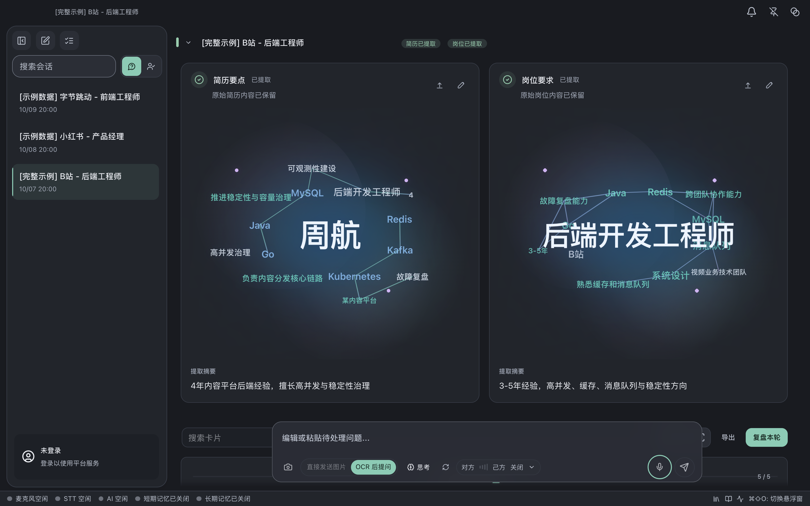
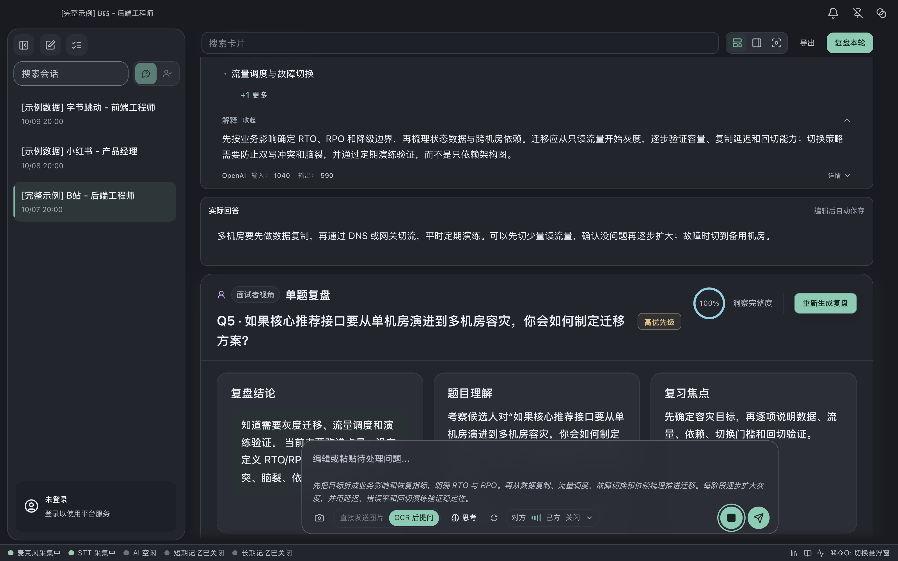
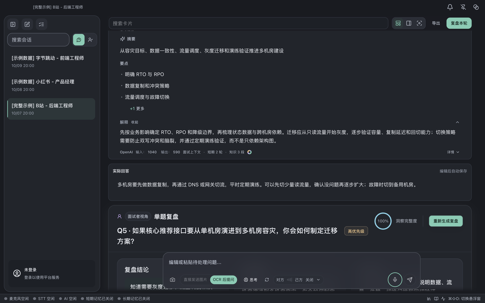
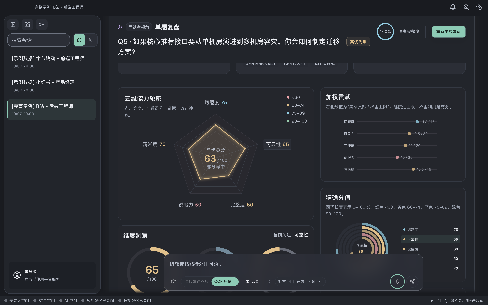
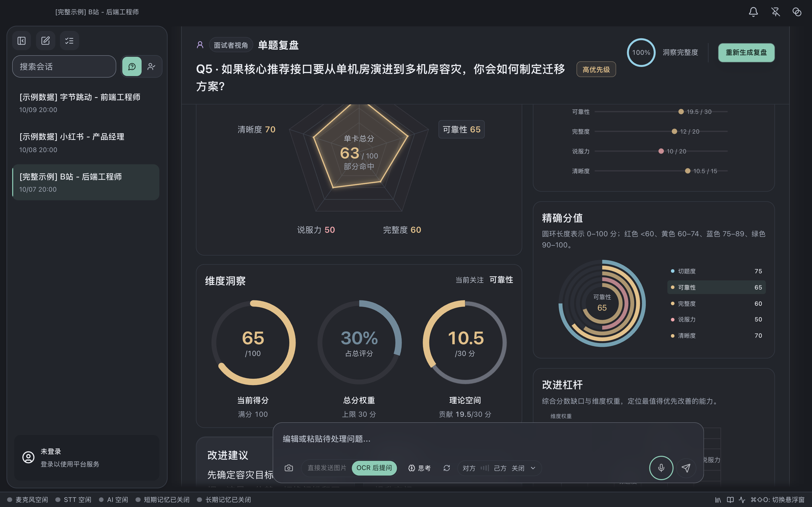
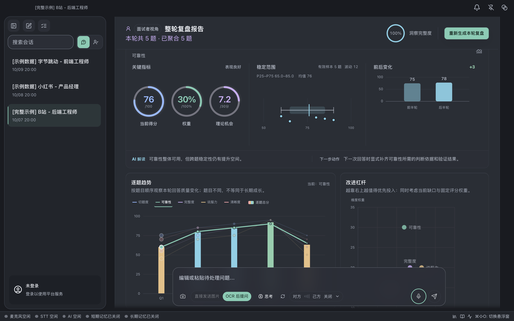
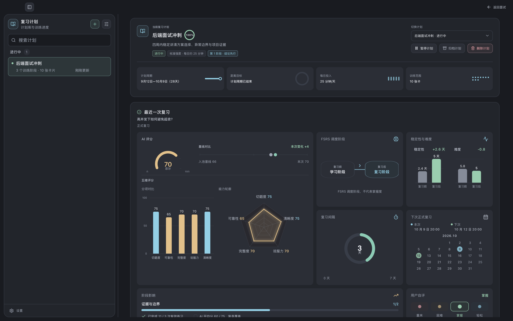
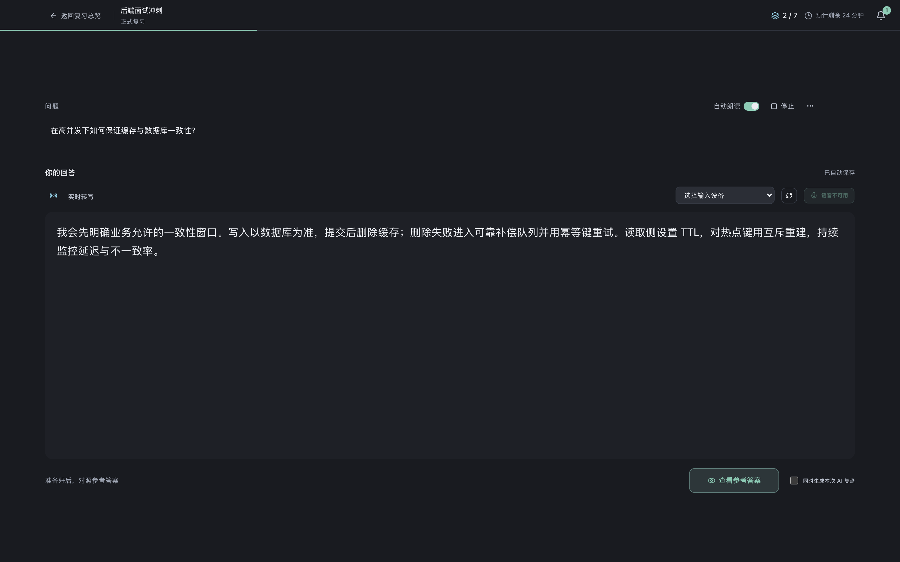
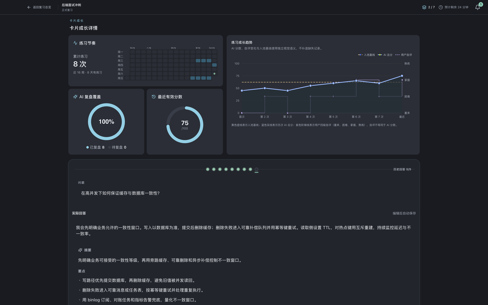

# 面试舱｜面试准备、实时辅助与复盘练习

**简体中文** | [English](README_EN.md)

> 从面试前准备，到面试中的实时辅助，再到面试后的复盘练习，把关键流程放在一个桌面工作区里。

[下载最新版](https://github.com/sherlockirene/ai-interviewer-downloads/releases/latest) ·
[使用文档](https://www.simpleloop.cn/docs) ·
[官网与账号](https://www.simpleloop.cn)

## 面试舱能帮你做什么

面试舱围绕一次完整的面试过程设计：提前整理简历与岗位背景，面试中查看实时语音转写和 AI 辅助回答，结束后复盘单题与整场表现，并把需要加强的内容加入后续练习。

## 产品功能

### 面试前：整理简历与岗位背景

提前补充简历和职位信息，为面试过程准备清晰的上下文。

### 面试中：跟上对话，整理思路

实时查看语音转写，并在需要时参考 AI 辅助回答卡片。

  
  

### 面试后：复盘问题与整场表现

从单题回顾、分析到整场报告，梳理回答中的亮点和可改进之处。

  
  
  

### 持续复习：制定计划并练习作答

将复盘内容转化为练习计划，先独立作答，再查看参考答案。

  
  
  

## 下载与安装

[前往 GitHub Releases 下载最新版](https://github.com/sherlockirene/ai-interviewer-downloads/releases/latest)

v0.2.17 当前提供：

| 系统 | 安装包 | 安装方式 |
| --- | --- | --- |
| macOS Apple Silicon（arm64） | `ai-interviewer-v0.2.17-mac-arm64.dmg` 或 `.zip` | 打开 DMG，将应用拖入“应用程序” |
| Windows x64（预览版） | `ai-interviewer-v0.2.17-windows-x64-setup.exe` | 运行安装程序并按提示完成安装 |

每个版本页面会列出该版本实际提供的系统和安装包，请按自己的设备选择。

## 首次使用

1. 在[官网注册账号](https://www.simpleloop.cn/register)。
2. 启动桌面客户端，使用同一账号登录。
3. 在设置中选择 AI 服务，并按页面提示完成配置。
4. 面试前补充简历和岗位背景。
5. 开始面试时选择合适的音频输入设备，并按系统提示开启所需权限。
6. 面试结束后查看单题复盘、整场报告或复习计划。

## 音频与 AI 配置

语音转写只会处理当前选定输入设备收到的声音。开始面试前，请检查应用中的输入设备选择和系统麦克风、语音识别权限。

AI 辅助回答需要登录账号，并完成所选 AI 服务的配置。遇到回答未生成时，可先检查账号状态、服务配置和网络连接。

## 常见问题

**语音转写没有文字？**  
检查输入设备是否选对，并确认系统已授予应用所需的麦克风和语音识别权限。

**AI 辅助回答没有出现？**  
确认已经登录，并检查 AI 服务是否配置完成、网络是否正常。

**应该下载哪个安装包？**  
macOS Apple Silicon 选择 `mac-arm64`；Windows 64 位选择 `windows-x64-setup.exe`。请以对应 Release 页面列出的附件为准。

**如何更新？**  
从 [GitHub Releases](https://github.com/sherlockirene/ai-interviewer-downloads/releases/latest) 下载所需版本的安装包。

## 更多帮助

- [面试舱使用文档](https://www.simpleloop.cn/docs)
- [官网](https://www.simpleloop.cn)
- 客服邮箱：support@simpleloop.cn
