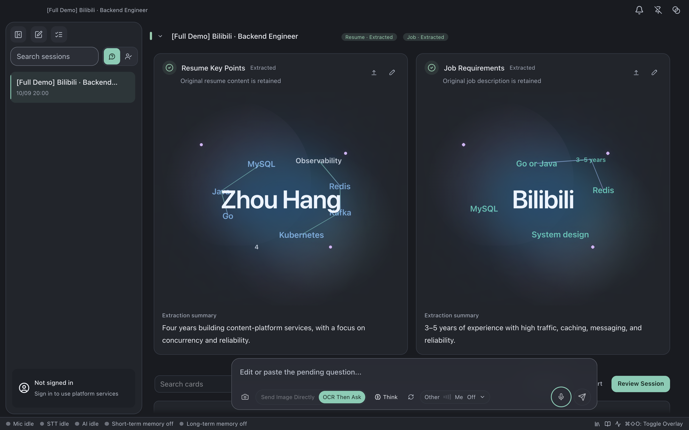
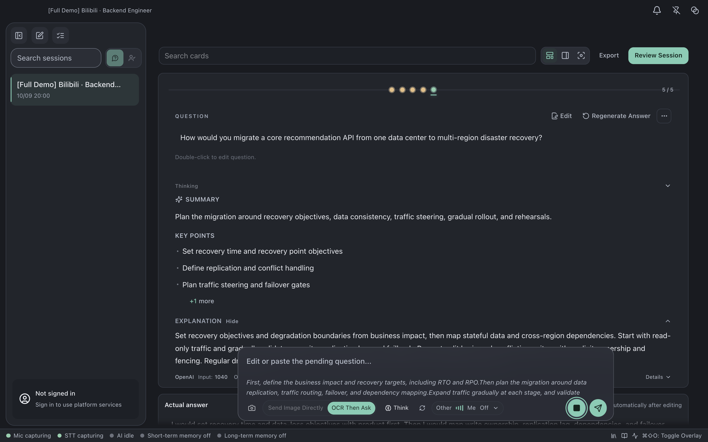
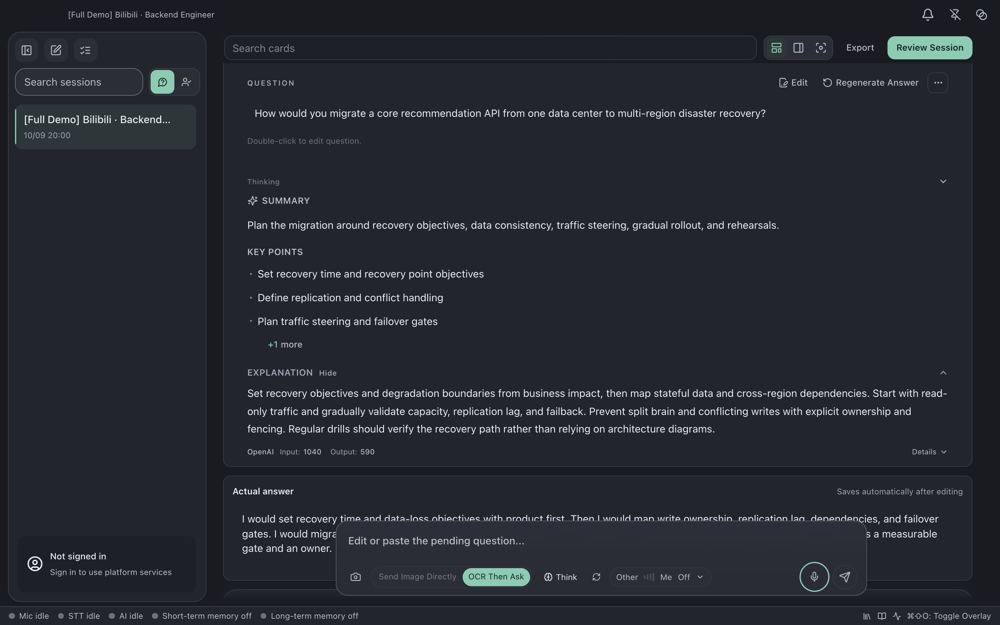
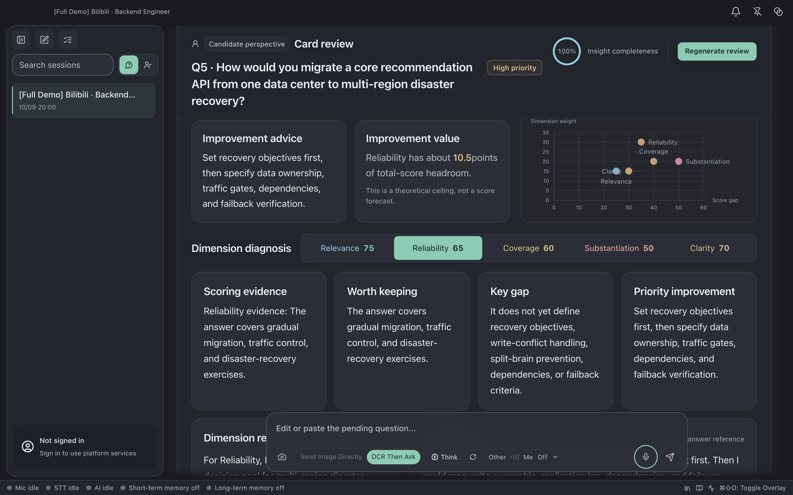
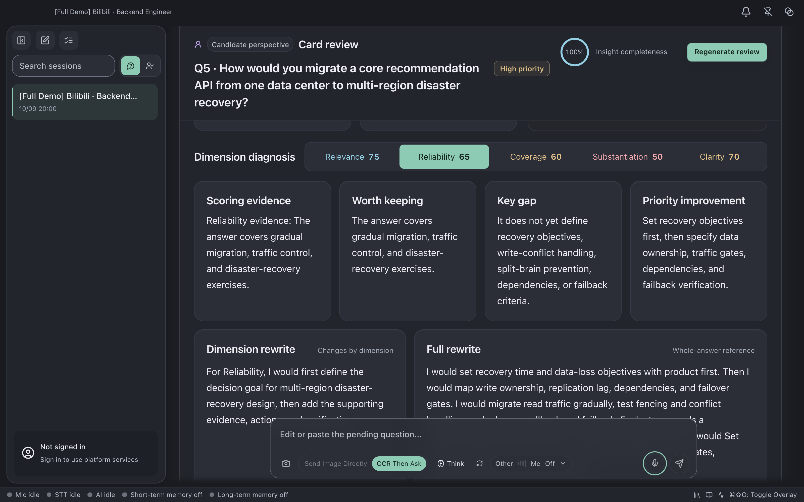
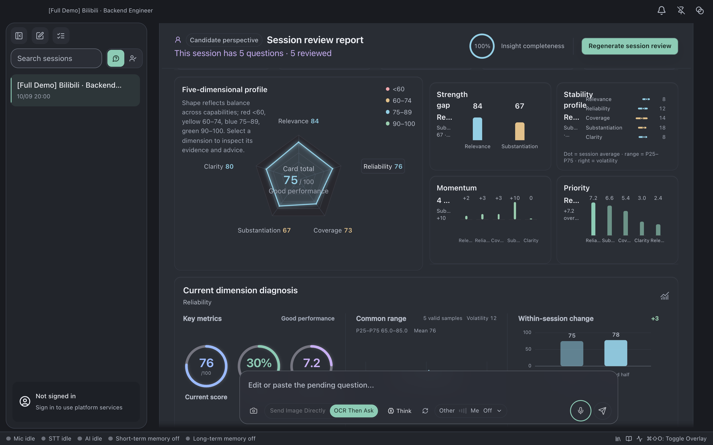
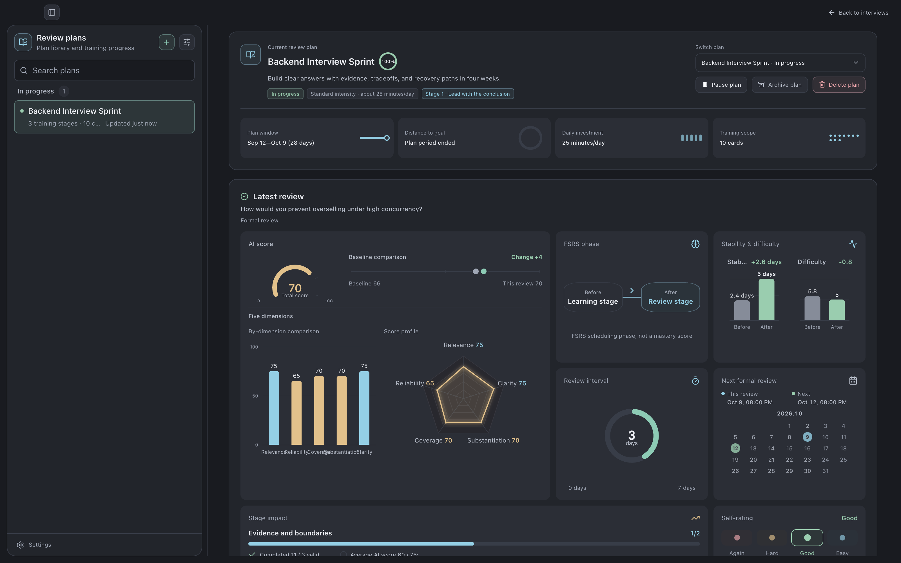
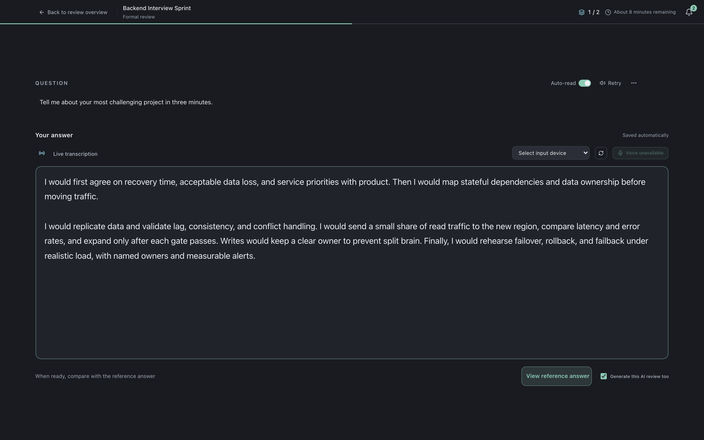
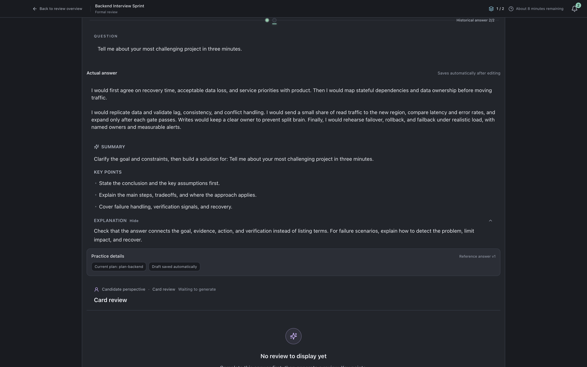

# 面试舱 (AI Interviewer)

[简体中文](README.md) | **English**

> Prepare before the interview, stay focused during it, and turn each conversation into a plan for improvement.

[Download the latest version](https://github.com/sherlockirene/ai-interviewer-downloads/releases/latest) ·
[User guide (Chinese)](https://www.simpleloop.cn/docs) ·
[Website and account](https://www.simpleloop.cn)

## What you can do with 面试舱

面试舱 brings interview preparation, live transcription, AI-assisted answer prompts, and post-interview review into one desktop workflow. Add your resume and role details before an interview, follow the conversation as it happens, then review individual questions and plan what to practice next.

## Product tour

### Prepare your interview context

Add your resume and role information before the interview so the session has the context you need.

### Follow the conversation and organize your thoughts

See live speech transcription and refer to AI-assisted answer cards when you need another angle.

  
  

### Review questions and the full interview

Look back at individual questions, review the analysis, and use the session report to identify strengths and areas to improve.

  
  
  

### Turn review into practice

Build a review plan, practice your own answers, and reveal reference answers when you are ready.

  
  
  

## Download and install

[Get the latest release from GitHub](https://github.com/sherlockirene/ai-interviewer-downloads/releases/latest)

Version 0.2.17 currently includes:

| System | Installer | Install steps |
| --- | --- | --- |
| macOS Apple silicon (arm64) | `ai-interviewer-v0.2.17-mac-arm64.dmg` or `.zip` | Open the DMG and drag the app to Applications. |
| Windows x64 (preview) | `ai-interviewer-v0.2.17-windows-x64-setup.exe` | Run the installer and follow its prompts. |

Each release lists the systems and installers available for that version. Choose the file that matches your device.

## Get started

1. [Create an account on the website](https://www.simpleloop.cn/register).
2. Open the desktop app and sign in with the same account.
3. Choose an AI service in Settings and complete its configuration.
4. Add your resume and role details before the interview.
5. Before starting, select the audio input you need and grant the permissions requested by your system.
6. After the interview, review questions, read the session report, or add topics to your review plan.

## Audio and AI setup

Speech transcription processes audio received by the input device selected in the app. Before starting, check the selected device and grant the microphone and speech-recognition permissions requested by your system.

AI-assisted answers require a signed-in account and a configured AI service. If answers do not appear, check your account, service configuration, and network connection.

## Frequently asked questions

**Why is there no transcription?**  
Check that the right input device is selected and that the app has the microphone and speech-recognition permissions it needs.

**Why are AI answer cards missing?**  
Make sure you are signed in, your AI service is configured, and your network connection is working.

**Which installer should I download?**  
For macOS on Apple silicon, choose `mac-arm64`. For 64-bit Windows, choose `windows-x64-setup.exe`. Check the release page for the files available in each version.

**How do I update?**  
Download the version you need from [GitHub Releases](https://github.com/sherlockirene/ai-interviewer-downloads/releases/latest).

## More help

- [面试舱 user guide (Chinese)](https://www.simpleloop.cn/docs)
- [面试舱 website](https://www.simpleloop.cn)
- Support: [support@simpleloop.cn](mailto:support@simpleloop.cn)
